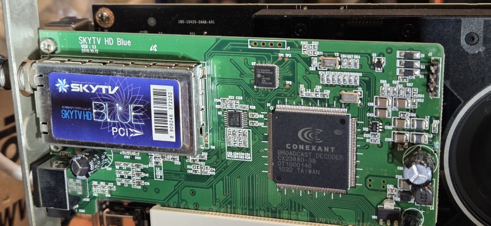
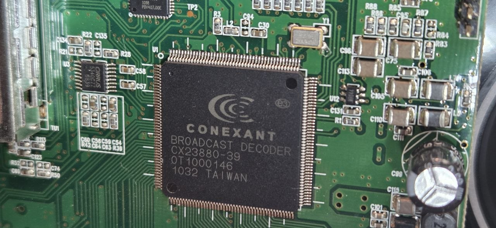
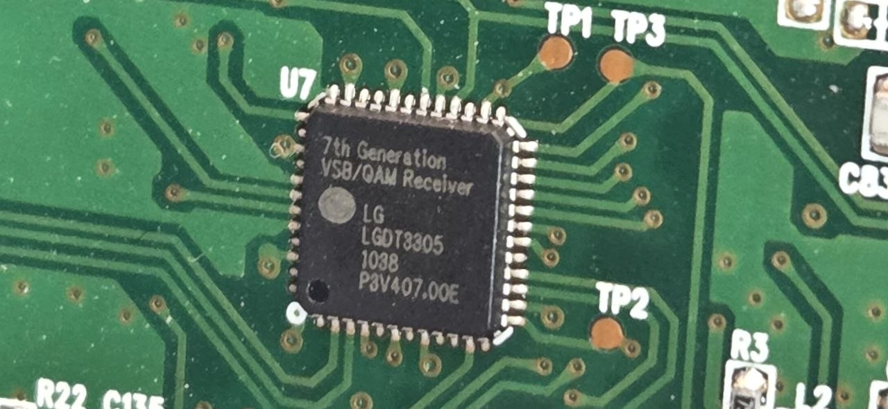
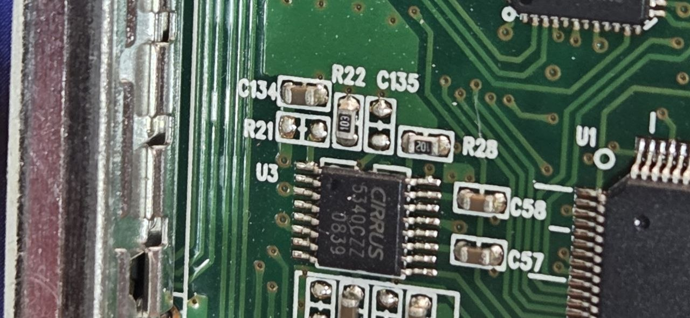
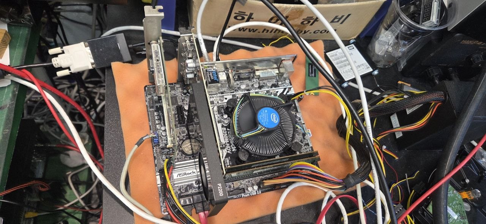
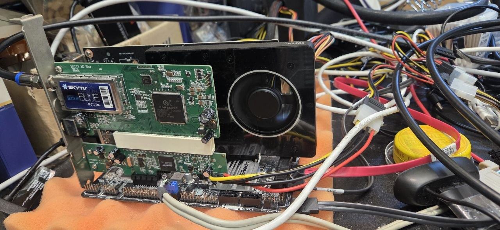

# cx88-skytv — Linux ATSC driver for SKYTV HD Blue PCI

Skydigital **SKYTV HD Blue PCI** (CX23880 + LG LGDT3305, PCI subsystem `19b8:0464`)를
Linux에서 ATSC(8VSB) 지상파 수신 카드로 쓰기 위한 cx88 드라이버 패치와 DKMS 패키지입니다.

Stock Linux recognizes this card only as `UNKNOWN/GENERIC [card=0]` with no DVB frontend.
This package adds board support (card=92) to the cx88 driver and ships it as a DKMS module.



## 하드웨어 / Hardware

| CX23880-39 브리지 (U1) | LG LGDT3305 복조기 (U7, I2C 0x0e) | Cirrus CS5340 오디오 ADC (U3) |
|---|---|---|
|  |  |  |

튜너는 금속 캔(TU1, PLL I2C 0x61) 안에 있습니다. GPIO·튜너·복조기 상세는 [docs/HARDWARE.md](docs/HARDWARE.md) 참고.

## 동작 확인 환경 / Tested

| 항목 | 값 |
|---|---|
| 커널 | Ubuntu 7.0.0 (`7.0.0-26260609-generic`), cx88 소스는 Linux v7.0 기준 |
| 수신 | 서울 ATSC 지상파: MBC 473 MHz, KBS1 479 MHz, SBS 485 MHz, KBS2 491 MHz |
| 결과 | 8VSB lock, 1080i MPEG-2 + AC3 TS 정상 녹화 |

| 테스트 시스템 (ASRock B250M-HDV) | 카드 장착 상태 |
|---|---|
|  |  |

지원 범위: **ATSC 8VSB 디지털 수신만** 검증했습니다. QAM(케이블)·아날로그 TV 튜너는 구현/검증하지 않았습니다.
컴포지트/S-Video 입력은 보드 정의만 있고 검증하지 않았습니다.

## 설치 / Install (DKMS)

```sh
sudo apt install dkms linux-headers-$(uname -r)
git clone <this repo> cx88-skytv && cd cx88-skytv
sudo ./install.sh
```

`install.sh`는 소스를 `/usr/src/cx88-skytv-1.0`에 복사하고 `dkms add/build/install` 후
실행 중인 cx88 모듈을 새 모듈로 교체합니다. 모듈은 `/lib/modules/<ver>/updates/dkms/`에
설치되어 커널 기본 cx88보다 우선 로드됩니다. 커널 업데이트 시 DKMS가 자동으로 다시 빌드합니다
(`BUILD_EXCLUSIVE_KERNEL="^7\.0\."` — 7.0.x 커널에만 빌드).

제거: `sudo ./uninstall.sh`

## 사용 / Usage

```sh
dmesg | grep -i skytv          # "SKYTV HD Blue PCI [card=92,autodetected]"
ls /dev/dvb/adapter0           # demux0 dvr0 frontend0 net0

# 한국 UHF 14~51 채널 스캔 (채널 중심 주파수 473 + 6*(n-14) MHz)
for n in $(seq 14 51); do
  printf "[CH%d]\n\tDELIVERY_SYSTEM = ATSC\n\tFREQUENCY = %d\n\tMODULATION = VSB/8\n\n" \
    $n $(( (473 + 6*(n-14)) * 1000000 ))
done > kr-atsc-uhf.conf
dvbv5-scan -a 0 -o channels.conf kr-atsc-uhf.conf

# 녹화 (서비스 이름은 channels.conf의 [ ] 안 문자열 그대로, 공백 포함)
dvbv5-zap -a 0 -c channels.conf -p -r -o sbs.ts -t 30 "SBS    "
```

참고: `dvbv5-zap`/`dvbv5-scan`의 `Signal=`은 lgdt3305 드라이버가 SNR로 계산하는 값이라
**lock 전에는 항상 0%** 입니다. 신호 유무 판단용이 아닙니다.

## 모듈 파라미터 (cx88-dvb)

| 파라미터 | 기본값 | 설명 |
|---|---|---|
| `skytv_if_khz` | 44000 | 튜너 LO 오프셋(IF, kHz) |
| `skytv_cb` / `skytv_ab` | 0x93 / 0xc2 | 튜너 PLL 제어 바이트 / 5번째 바이트 |
| `skytv_inversion` | 0 | 스펙트럼 반전 (런타임 변경 가능) |
| `skytv_as_3304` | 1 | 복조기를 LGDT3304 레지스터 셋(High IF)으로 구동 |
| `skytv_serial`, `skytv_ts_gen_cntrl` | 0, 0 | TS 출력 모드 |
| `debug` | 0 | 1이면 튜너 바이트 등 디버그 로그 |

기본값으로 동작하므로 보통 바꿀 필요가 없습니다.

## 구성 / Layout

```
dkms.conf, install.sh, uninstall.sh
src/                 cx88 (Linux v7.0) + SKYTV patch, inc/ = 필요한 frontend/tuner 헤더
patches/             upstream v7.0 대비 패치 (cx88.h, cx88-cards.c, cx88-dvb.c)
docs/HARDWARE.md     하드웨어 분석 노트 (GPIO, 튜너 프로토콜, 복조기 설정)
tools/               gpio_probe.py (GPIO/I2C 탐색), load_test.sh (설치 없이 임시 로드)
.claude/skills/      Claude Code용 skill 문서
```

## 라이선스 / License

GPL-2.0 (Linux cx88 드라이버 파생물). `LICENSE` 참고.
Windows 드라이버 파일은 포함하지 않습니다. 하드웨어 동작은 Windows 드라이버의
상호운용성 분석으로 확인했습니다 (`docs/HARDWARE.md`).
